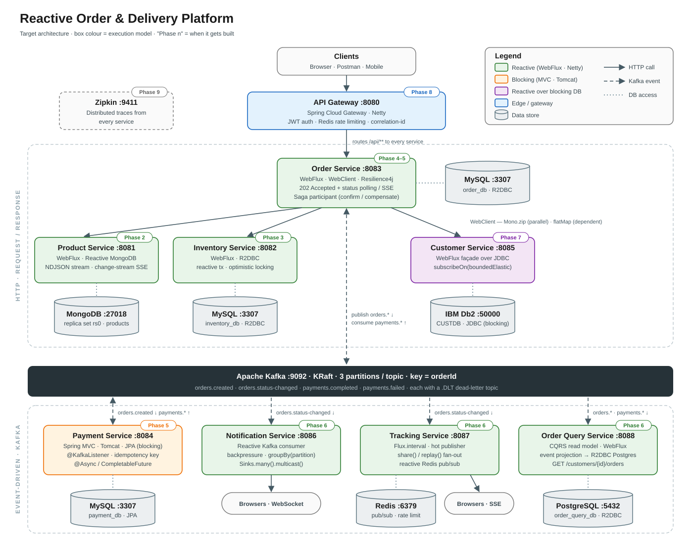

# Reactive Order & Delivery Platform

A microservices playground for **Reactive Programming, Spring WebFlux, asynchronous APIs and Kafka**,
using reactive (MongoDB, R2DBC) and blocking (JPA, IBM DB2) data stores side by side.

**Stack:** Java 21 · Spring Boot 4.0.9 · Spring Cloud 2025.1.4 · Maven 3.9.16 (via wrapper) · Docker Compose

---

## Architecture



Diagrams live in [docs/architecture/](docs/architecture/): the target architecture, plus one diagram added at the end of each phase.

| Phase | Diagram |
|---|---|
| Target | [target-architecture.svg](docs/architecture/target-architecture.svg) |
| 1 | [phase-1-reactor-model.svg](docs/architecture/phase-1-reactor-model.svg): Reactive Streams protocol, assembly/subscription, schedulers, the flatMap family |
| 2 | [phase-2-product-service.svg](docs/architecture/phase-2-product-service.svg): request/response, NDJSON streaming, SSE push from a change stream |

**Interview prep:** [docs/interview/README.md](docs/interview/README.md) covers how to explain reactive concepts and the system design. It grows each phase.

<details><summary>Text version</summary>

```
                    ┌─────────────────────────┐
  Client ──────────▶│  API Gateway  :8080     │  Spring Cloud Gateway (reactive), JWT, Redis rate limiting
                    └──────────┬──────────────┘
        ┌──────────────┬───────┴──────┬──────────────┬───────────────┐
        ▼              ▼              ▼              ▼               ▼
  Product :8081   Inventory :8082  Order :8083   Payment :8084   Customer :8085
  WebFlux +       WebFlux +        WebFlux       Spring MVC +    WebFlux bridge
  Reactive Mongo  R2DBC (MySQL)    orchestrator  JPA + MySQL     over DB2 (JDBC)
                                      │
                               ┌──────┴──────┐
                               ▼   Kafka     ▼
                     Notification :8086   Tracking :8087      Order Query :8088
                     reactive consumer,   SSE, hot streams,   CQRS read model,
                     WebSocket push       reactive Redis      R2DBC PostgreSQL
```

</details>

## Modules

| Module | Port | Stack | Phase |
|---|---|---|---|
| `common` | – | Plain Java: event records, `ErrorResponse`, topic and header constants | 0 |
| `reactor-playground` | – | Project Reactor + StepVerifier exercises (no Spring) | 1 |
| `product-service` | 8081 | WebFlux, Reactive MongoDB | 2 |
| `inventory-service` | 8082 | WebFlux, R2DBC MySQL | 3 |
| `order-service` | 8083 | WebFlux, WebClient, Resilience4j, Kafka | 4–5 |
| `payment-service` | 8084 | **Spring MVC** (blocking on purpose), JPA, MySQL | 5 |
| `notification-service` | 8086 | WebFlux, reactive Kafka consumer, WebSocket | 6 |
| `tracking-service` | 8087 | WebFlux, SSE, reactive Redis | 6 |
| `order-query-service` | 8088 | **CQRS read model**: Kafka event projection into R2DBC PostgreSQL | 6 |
| `customer-service` | 8085 | WebFlux over blocking DB2 JDBC | 7 |
| `api-gateway` | 8080 | Spring Cloud Gateway (WebFlux) | 8 |

## Infrastructure (`infra/docker-compose.yml`)

| Component | Host port | Notes |
|---|---|---|
| Kafka 4.2 (KRaft) | 9092 | Topics pre-created by `kafka-init` (3 partitions each, plus `.DLT` topics) |
| Kafka UI | 8090 | http://localhost:8090 |
| MongoDB 8.0 | **27018** | Single-node replica set `rs0` (required for change streams). Port 27018 because a local MongoDB install uses 27017 |
| MySQL 8.4 | **3307** | Schemas `inventory_db`, `order_db`, `payment_db`; user `app`/`app` |
| PostgreSQL 17 | 5432 | `order_query_db` (CQRS read model); user `app`/`app` |
| Redis 8.2 | 6379 | |
| Zipkin 3.6 | 9411 | http://localhost:9411 |
| IBM Db2 12.1 | 50000 | Opt-in profile `legacy`; database `CUSTDB`, user `db2inst1` |

Credentials are local-dev only and live in `infra/.env`.

---

## Getting started

### 1. One-time: trust store setup (Windows with Norton / HTTPS-scanning antivirus)
Norton intercepts HTTPS. Java doesn't trust its certificate, so Maven fails with `PKIX path building failed`.
To fix this, point Java at the Windows certificate store:

```powershell
# current terminal only
$env:MAVEN_OPTS = "-Djavax.net.ssl.trustStoreType=Windows-ROOT"

# or permanently for your user (open a new terminal / restart VS Code afterwards)
[Environment]::SetEnvironmentVariable("MAVEN_OPTS", "-Djavax.net.ssl.trustStoreType=Windows-ROOT", "User")
```

### 2. Start the infrastructure
```powershell
cd infra
docker compose up -d --wait                  # core infra
docker compose --profile legacy up -d        # + IBM Db2 (≈3 GB image, first start takes several minutes)
docker compose ps
```

Stop with `docker compose stop` (keeps data). `docker compose down -v` wipes the volumes.

### 3. Build and test
```powershell
.\mvnw.cmd verify                            # all modules
.\mvnw.cmd -pl product-service -am verify    # one service plus the modules it depends on
```

### 4. Run a service
```powershell
.\mvnw.cmd -pl product-service -am spring-boot:run
curl http://localhost:8081/actuator/health
```

---

## Phase roadmap

- [x] **Phase 0** – Foundation: multi-module build, `common` contracts, Docker infrastructure
- [x] **Phase 1** – Reactor fundamentals: 73 tests in [`reactor-playground`](reactor-playground/README.md) · [diagram](docs/architecture/phase-1-reactor-model.svg)
- [x] **Phase 2** – Product Service: WebFlux + reactive MongoDB, NDJSON streaming, SSE from a change stream · [guide](product-service/README.md) · [diagram](docs/architecture/phase-2-product-service.svg)
- [ ] **Phase 3** – Inventory Service: R2DBC + reactive transactions
- [ ] **Phase 4** – Order Service: WebClient, `Mono.zip`, Resilience4j, 202 async API
- [ ] **Phase 5** – Kafka, Payment Service (MVC), saga + compensation
- [ ] **Phase 6** – Notification + Tracking: backpressure, SSE, WebSocket, Sinks · Order Query: CQRS read model on PostgreSQL
- [ ] **Phase 7** – Customer Service: DB2 blocking bridge, BlockHound
- [ ] **Phase 8** – API Gateway + Security
- [ ] **Phase 9** – Observability, Testcontainers, performance (WebFlux vs MVC vs Virtual Threads)
- [ ] **Phase 10** – Interview polish

## Kafka topics

| Topic | Producer → Consumer | Event |
|---|---|---|
| `orders.created` | order → payment, order-query | `OrderCreatedEvent` |
| `payments.completed` | payment → order, order-query | `PaymentCompletedEvent` |
| `payments.failed` | payment → order, order-query | `PaymentFailedEvent` (triggers compensation) |
| `orders.status-changed` | order → notification, tracking, order-query | `OrderStatusChangedEvent` |

Each topic has a matching `<topic>.DLT` dead-letter topic. The message key is always `orderId`, which keeps events for one order in order within its partition.
