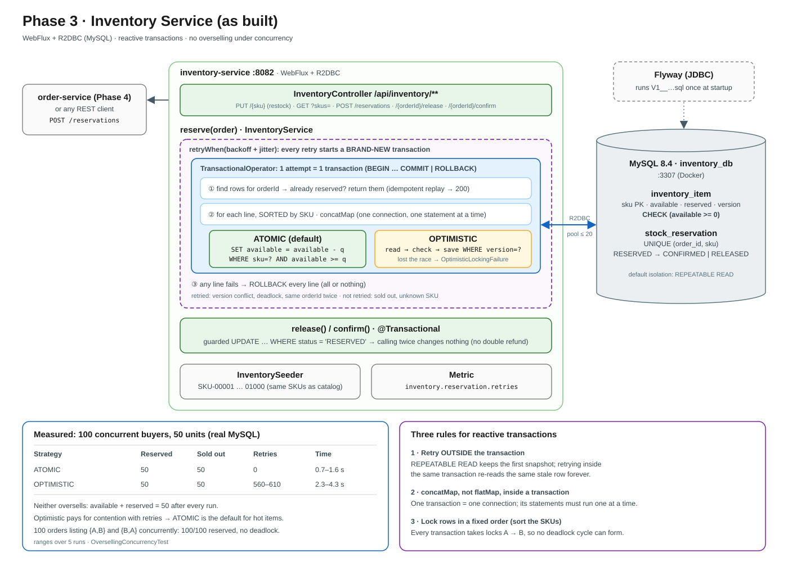

# Phase 3: Inventory Service

Stock levels and order reservations on **Spring WebFlux + R2DBC (MySQL)**. It's built around one interview question: *"100 people try to buy the last 50 units at the same moment. What happens?"*



## Run it
```powershell
cd infra; docker compose up -d --wait; cd ..             # MySQL runs on host port 3307
.\mvnw.cmd -pl inventory-service -am spring-boot:run      # Flyway creates the tables, seeder adds stock
```
Then open [requests.http](requests.http) in VS Code and run the calls top to bottom.

## Endpoints

| Method | Path | What it shows |
|---|---|---|
| GET | `/api/inventory/{sku}` | one stock level |
| GET | `/api/inventory?skus=A,B,C` | many SKUs in one query (`Flux`) |
| PUT | `/api/inventory/{sku}` | restock as an atomic UPSERT |
| POST | `/api/inventory/reservations` | **all-or-nothing** reservation; 201 when new, 200 on replay (idempotent) |
| GET | `/api/inventory/reservations/{orderId}` | look up a reservation |
| POST | `/api/inventory/reservations/{orderId}/release` | saga compensation, idempotent |
| POST | `/api/inventory/reservations/{orderId}/confirm` | payment done: reserved stock becomes sold |

The reservation lifecycle: `RESERVED → CONFIRMED` (paid) or `RESERVED → RELEASED` (cancelled). Order Service will drive this in Phases 4–5.

## Where to look in the code

| File | Read it for |
|---|---|
| [InventoryService](src/main/java/com/reactiveplatform/inventory/service/InventoryService.java) | `TransactionalOperator` + `retryWhen` order, `concatMap` in a transaction, `@Transactional`, SKU sorting |
| [AtomicStockUpdater](src/main/java/com/reactiveplatform/inventory/service/AtomicStockUpdater.java) | check-and-decrement in one SQL statement (`DatabaseClient`) |
| [OptimisticStockUpdater](src/main/java/com/reactiveplatform/inventory/service/OptimisticStockUpdater.java) | read, check, save with `@Version` |
| [V1__create_inventory_tables.sql](src/main/resources/db/migration/V1__create_inventory_tables.sql) | `CHECK (available >= 0)`, `UNIQUE (order_id, sku)` |
| [OversellingConcurrencyTest](src/test/java/com/reactiveplatform/inventory/OversellingConcurrencyTest.java) | 100 concurrent buyers vs 50 units, for both strategies |
| [InventoryApiIntegrationTest](src/test/java/com/reactiveplatform/inventory/InventoryApiIntegrationTest.java) | rollback, idempotency, state transitions, the CHECK safety net |

---

## How to explain it in an interview

### The 60-second walkthrough (practise saying this out loud)
> "The inventory service holds stock and reserves it for orders. It's WebFlux with R2DBC on MySQL, so database calls don't block threads either.
>
> A reservation is all or nothing: if an order has three items and the third is out of stock, the first two are rolled back. Each attempt runs in one reactive transaction.
>
> The interesting part is concurrency. To stop overselling I use a single conditional UPDATE: `SET available = available - q WHERE sku = ? AND available >= q`. The database checks and decrements in one step while holding the row lock, so two buyers can never both get the last unit. I measured it: 100 concurrent buyers for 50 units gives exactly 50 successes and 50 clean 'sold out' answers, with zero retries. I also built optimistic locking with a version column for comparison. It's just as correct, but needed about 600 retries and took 2–4 times as long, which is why the atomic update is the default for hot items. A CHECK constraint in the database is the last line of defence.
>
> Reservations are idempotent by order ID, so a retried request or a redelivered Kafka message never reserves twice."

### Design decisions, and what to say about each

| Decision | Say this |
|---|---|
| **R2DBC instead of JDBC/JPA** | "JDBC blocks a thread for every query, which would undo WebFlux. R2DBC is the non-blocking SQL API. The trade-off: no JPA features (no lazy loading, dirty checking, relationships or cascade), so I write SQL or use simple repositories." |
| **Flyway over JDBC** | "Flyway only speaks JDBC, so it runs the migrations once at startup over JDBC. Every request after that goes through R2DBC. Both drivers are on the classpath, for different jobs." |
| **Atomic conditional UPDATE (default)** | "Check and change in one statement under the row lock. It's correct under any contention and needs no retries. Measured over five runs: 0 retries, 0.7–1.6 s for 100 buyers." |
| **Optimistic locking (`@Version`)** | "Read, check in code, save with `WHERE version = ?`. No locks are held between read and write, which is good when conflicts are rare, like editing a product. Under a flash sale most attempts lose: 560–610 retries, 2.3–4.3 s over five runs." |
| **Pessimistic locking (`SELECT … FOR UPDATE`)**, not built | "Also correct: lock first, then check and update. It's useful when the check needs logic that can't go in a WHERE clause. The cost is holding locks for the whole transaction." |
| **Reactive transactions** | "`@Transactional` works on methods returning Mono/Flux, and `TransactionalOperator` does the same programmatically. The transaction lives in the Reactor Context, not a ThreadLocal, because a reactive request can change threads." |
| **Retry outside the transaction** | "Each retry has to be a fresh transaction. Under MySQL's REPEATABLE READ a transaction reads from its first snapshot, so retrying inside it would re-read the same stale version and lose every time." |
| **`concatMap` inside a transaction** | "A transaction is one connection, and one connection runs one statement at a time. `flatMap` would fire statements concurrently on it; `concatMap` keeps them in sequence." |
| **Sort SKUs before locking** | "If one order locks A then B and another locks B then A, they can deadlock. Sorting means everyone locks in the same order. Measured: 100 orders with opposite item order, 100 successes." |
| **Idempotent reservations** | "The order ID is the idempotency key, backed by a unique constraint. A retry returns the existing reservation with 200 instead of reserving again, which matters once Kafka redelivers messages." |
| **Guarded state changes** | "Release runs `UPDATE … WHERE status = 'RESERVED'`. If two releases race, only one changes the row, so the stock is never refunded twice." |
| **CHECK constraint** | "Defence in depth: even a bug or a manual SQL fix can't make stock negative. There's a test that bypasses the service and proves the database refuses it." |
| **SKU as the shared key** | "The catalog uses Mongo ObjectIds and inventory uses MySQL keys. Services share the business key, the SKU, never each other's internal IDs." |

### Questions you're likely to get

**"How do you prevent overselling?"** Name the options (atomic conditional update, optimistic locking, pessimistic locking), say which you chose and why, and quote the measured result. Mention the CHECK constraint as a backstop.

**"Optimistic or pessimistic locking?"** Optimistic when conflicts are rare: no locks held, but you pay with retries under contention. Pessimistic or atomic when contention is high, as with hot items. "I measured optimistic at about 6 retries per buyer under contention."

**"How do transactions work in WebFlux?"** The same `@Transactional` annotation on methods returning Mono/Flux, with an R2DBC transaction manager. The transaction is bound to the subscription's Reactor Context. Gotcha: everything inside it must be part of the same reactive chain. If you `subscribe()` separately inside, that work runs outside the transaction.

**"What if the same request arrives twice?"** The order ID is an idempotency key backed by a unique constraint: the second call returns the first result. Release and confirm are also safe to repeat.

**"How would you scale this?"** Stock rows are independent, so the service scales horizontally. The database is the shared bottleneck, and for an extreme flash sale on one SKU you'd add things like a queue in front of that item or pre-allocating stock buckets.

### Gotchas to know
1. **Assigned IDs and `save()`:** Spring Data decides between INSERT and UPDATE by asking whether the entity is new. With an ID you assign yourself (the SKU), it would always pick UPDATE. Here the `@Version` field being `null` tells Spring Data the row is new; alternatively you can implement `Persistable` or call `template.insert()` directly.
2. **R2DBC isn't JPA:** no `@OneToMany`. Reservation rows are loaded with a separate query (`findByOrderIdOrderBySku`).
