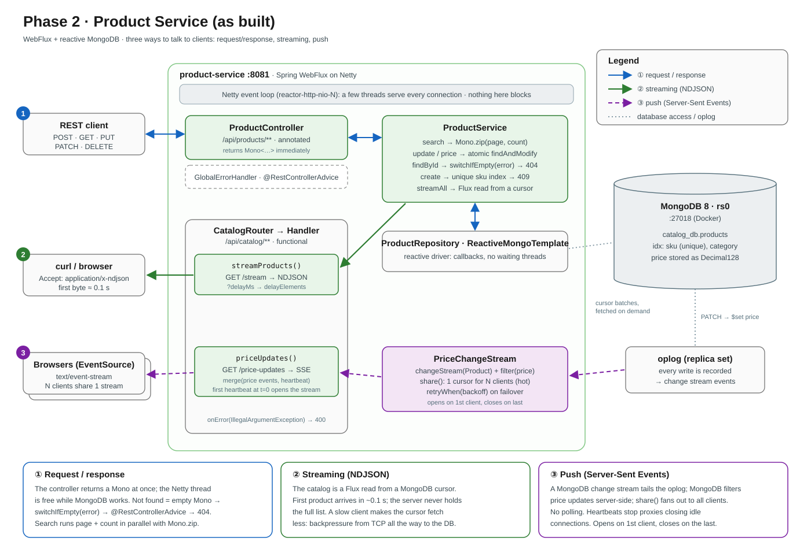

# Phase 2: Product Service

Product catalog on **Spring WebFlux + reactive MongoDB**. It talks to clients in three styles: request/response, streaming, and push.



## Run it
```powershell
cd infra; docker compose up -d --wait; cd ..           # MongoDB runs on host port 27018
.\mvnw.cmd -pl product-service -am spring-boot:run      # seeds 1,000 sample products on first start
```
Then open [requests.http](requests.http) in VS Code and click **Send Request** above any call. For the live price stream, use a terminal:
```powershell
curl.exe -N http://localhost:8081/api/catalog/price-updates     # leave this running
# ...then send request 6 (PATCH price) from requests.http and watch the event arrive
```

## Endpoints

| Method | Path | Style | What it shows |
|---|---|---|---|
| POST | `/api/products` | annotated | `@Valid`, 201 + `Location`, unique index → 409 |
| GET | `/api/products/{id}` | annotated | empty `Mono` → 404 |
| GET | `/api/products?category&q&minPrice&maxPrice&page&size` | annotated | dynamic query, pagination with `Mono.zip` |
| PUT | `/api/products/{id}` | annotated | atomic `findAndModify` (price excluded) |
| PATCH | `/api/products/{id}/price` | annotated | price change, which also triggers SSE |
| DELETE | `/api/products/{id}` | annotated | 204 / 404 |
| GET | `/api/catalog/stream?delayMs` | functional | NDJSON streaming straight from a MongoDB cursor |
| GET | `/api/catalog/price-updates` | functional | Server-Sent Events from a MongoDB change stream |

## Where to look in the code

| File | Read it for |
|---|---|
| [ProductController](src/main/java/com/reactiveplatform/product/web/ProductController.java) | WebFlux looks like MVC; methods return `Mono` |
| [ProductService](src/main/java/com/reactiveplatform/product/service/ProductService.java) | `switchIfEmpty(Mono.error(...))`, `Mono.zip` pagination, atomic updates |
| [CatalogRouter](src/main/java/com/reactiveplatform/product/web/CatalogRouter.java) + [CatalogStreamHandler](src/main/java/com/reactiveplatform/product/web/CatalogStreamHandler.java) | functional endpoints, NDJSON, SSE + heartbeat |
| [PriceChangeStream](src/main/java/com/reactiveplatform/product/streaming/PriceChangeStream.java) | change stream, `share()` (hot), `retryWhen` |
| [GlobalErrorHandler](src/main/java/com/reactiveplatform/product/web/GlobalErrorHandler.java) | one error format for every failure |
| [ProductControllerTest](src/test/java/com/reactiveplatform/product/web/ProductControllerTest.java) | slice test: `@WebFluxTest` + mocked service |
| [ProductApiIntegrationTest](src/test/java/com/reactiveplatform/product/ProductApiIntegrationTest.java) | real HTTP + real MongoDB (Testcontainers), including SSE |

---

## How to explain it in an interview

### The 60-second walkthrough (practise saying this out loud)
> "The product service is the catalog. It's built on Spring WebFlux with reactive MongoDB, because the catalog is read-heavy and mostly waits on I/O.
>
> A request comes in on a Netty event-loop thread. The controller doesn't fetch the data itself; it returns a `Mono`, a description of the work, and the thread goes back to serving other requests. When MongoDB answers, the driver calls back and WebFlux writes the response. So a few threads can handle thousands of concurrent requests.
>
> It talks to clients three ways. Normal CRUD is request/response. For bulk export I **stream** the catalog as NDJSON straight from a database cursor: the first product arrives in about 100 ms and memory stays flat, because backpressure goes from the client's TCP connection back to the cursor. For live prices I **push** Server-Sent Events from a MongoDB change stream: no polling, one shared stream no matter how many browsers are connected."

### Design decisions, and what to say about each

| Decision | Say this |
|---|---|
| **MongoDB for the catalog** | "A product is always read as a whole, attributes vary by category, and traffic is read-heavy. A document fits: one read, no joins." |
| **Annotated and functional endpoints** | "CRUD uses annotated controllers, which are familiar and come with validation and advice. Streaming uses functional routes, which are just functions and easy to test. One gotcha: `@RestControllerAdvice` doesn't cover functional routes, so the router has its own `onError`." |
| **"Not found" as an empty Mono** | "Reactive repositories return an empty `Mono`, not null. I turn that into an error with `switchIfEmpty(Mono.error(...))`, and the advice maps it to 404. I use the `Supplier` form so the exception is only created when the Mono really is empty." |
| **Pagination with `Mono.zip`** | "Reactive repositories have no `Page<T>`, so I run the content query and the count query in parallel with `Mono.zip`. Total time is the slower of the two, not the sum." |
| **Atomic updates (`findAndModify`)** | "Updates are a single `$set` in the database, not read-modify-save. Two concurrent updates can't overwrite each other, and it's one round trip." |
| **Duplicate SKU** | "A unique index enforces it, so it's race-free. Checking first in code would race. I translate `DuplicateKeyException` to 409." |
| **NDJSON instead of a JSON array** | "With an array the client waits for everything and the server builds the whole list in memory. NDJSON sends each object as it's read. Measured locally: first byte after 0.09 s, the full stream took 15 s." |
| **SSE instead of polling or WebSocket** | "Price updates only go server → client, so SSE is enough. It's plain HTTP, the browser reconnects automatically, and it passes through proxies. WebSocket is for two-way traffic; that's coming in the notification service." |
| **Change stream + `share()`** | "MongoDB pushes changes from its oplog, and I filter to price updates on the server. `share()` makes it hot, so a thousand browsers still mean one change stream, opened by the first client and closed by the last. `retryWhen` reconnects after a failover." |
| **Decimal128 for price** | "BigDecimal can end up stored as a string, and then '5' sorts above '10'. I store it as Decimal128; there's an integration test that would fail otherwise." |

### Questions you're likely to get

**"Why WebFlux here and not Spring MVC?"** The work is I/O-bound (database calls, long-lived streams), and SSE and streaming clients hold connections open for a long time. With one thread per connection, 10,000 SSE clients would need 10,000 threads; with Netty they need a handful.

**"What happens if a streaming client is slow?"** Netty stops reading from the Flux when the socket's send buffer is full, so demand stops, and the MongoDB driver stops fetching the next cursor batch. Nothing piles up in memory.

**"How would you scale the SSE endpoint to several instances?"** Each instance opens its own change stream, and MongoDB sends every instance every change, so any client on any instance gets all updates. No sticky sessions or message broker are needed for this case.

**"What if the client disconnects?"** The subscription is cancelled. `share()` counts subscribers, and when the last one leaves it cancels upstream, which closes the change stream (you can see this in the log).

**"How do you test it?"** There are two levels. `@WebFluxTest` with a mocked service covers HTTP concerns in milliseconds. `@SpringBootTest` with Testcontainers MongoDB covers the real flow, including an SSE test that changes a price and asserts the event arrives.

### Gotchas found while building it (good stories for "tell me about a problem you solved")
1. **Testcontainers 2.x starts MongoDB standalone**, and change streams fail with *"only supported on replica sets"*. The fix is `new MongoDBContainer("mongo:8.0").withReplicaSet()`.
2. **The price search returned 0 results against the seeded data.** The query was fine; the data wasn't. The seeder created `new Random(i)` per product, and neighbouring seeds produce almost identical first values, so every product cost about 365. I found it by checking the stored types and values in mongosh before blaming the query. The fix is one `Random(42)` for the whole run.
3. **Port clash with a locally installed MongoDB.** The app silently connected to a *different* MongoDB on `localhost:27017`. I caught it because the health endpoint listed unfamiliar databases. The fix was to move Docker MongoDB to port 27018, and the integration test now points the default URI at an invalid host, so a wiring mistake fails loudly instead of touching a real database.
