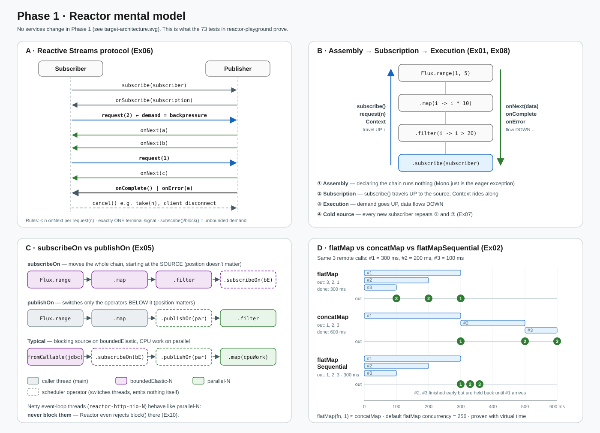

# Phase 1: Reactor playground

Plain Project Reactor, no Spring. Every concept is a test: read the code and its comments, run the test, then change something and watch it fail.



```powershell
.\mvnw.cmd -pl reactor-playground test                                  # all 73 tests
.\mvnw.cmd -pl reactor-playground test -Dtest=Ex02TransformingOperatorsTest  # one exercise
```
In VS Code you can also click ▶ next to any test method (Test Runner for Java).

## Exercises

| # | Class | Concepts |
|---|---|---|
| 1 | `Ex01CreatingPublishersTest` | `just`/`empty`/`error`, assembly vs subscription, **eager `just` vs lazy `defer`/`fromCallable`**, `generate` vs `create` |
| 2 | `Ex02TransformingOperatorsTest` | **`map` vs `flatMap` vs `concatMap` vs `flatMapSequential`** (timed with virtual time), `handle`, the `switchIfEmpty` eager-argument gotcha, `groupBy` |
| 3 | `Ex03CombiningPublishersTest` | **`Mono.zip` parallelism**, zip-with-empty gotcha, `merge` vs `concat`, `then`, `when`, `firstWithValue` |
| 4 | `Ex04ErrorHandlingTest` | `onErrorReturn`/`Resume`/`Map`, `onErrorContinue`, **`retry` vs `retryWhen(backoff)`**, retry exhaustion, `timeout`, `doFinally` |
| 5 | `Ex05SchedulersTest` | **`subscribeOn` vs `publishOn`**, `parallel` vs `boundedElastic`, `parallel().runOn()`, real concurrency with `flatMap` |
| 6 | `Ex06BackpressureTest` | `request(n)`, `BaseSubscriber`, `limitRate`, overflow strategies: **buffer / drop / latest** |
| 7 | `Ex07HotVsColdTest` | **cold vs hot**, `cache`, `share`, `publish().autoConnect`, `Sinks` (multicast, replay, unicast, one) |
| 8 | `Ex08ContextTest` | **Reactor `Context` vs ThreadLocal**, propagation direction, which `contextWrite` wins |
| 9 | `Ex09TestingToolsTest` | `StepVerifier`, virtual time, `TestPublisher`, `PublisherProbe` |
| 10 | `Ex10BlockingAndEventLoopTest` | why the event loop scales, wrapping blocking calls, **`block()` rejected on non-blocking threads** |

## Interview cheat sheet (one-line answers you can expand)

**Mono vs Flux?** Both are Reactive Streams `Publisher`s. Mono emits 0..1 items, Flux emits 0..N. Each signals `onNext*` and then exactly one terminal signal, `onComplete` or `onError`.

**What does "nothing happens until you subscribe" mean?** Building a chain (assembly) only describes the work. `subscribe()` sends a subscription up to the source; the source then emits as demand arrives. *(Ex01)*

**`Mono.just` vs `Mono.defer` / `fromCallable`?** `just` captures a value that has already been computed, at assembly time. `defer` and `fromCallable` compute it on every subscription, so retries and repeats actually re-run the work. *(Ex01, Ex04)*

**`map` vs `flatMap`?** `map` is a synchronous 1:1 transform. `flatMap` maps each element to a Publisher (an async call) and subscribes to those Publishers concurrently, so results come out in arrival order. *(Ex02)*

**`flatMap` vs `concatMap` vs `flatMapSequential`?** `flatMap` is concurrent and unordered. `concatMap` runs one call at a time in source order. `flatMapSequential` runs concurrently but releases results in source order. *(Ex02)*

**How do you call 3 services in parallel?** `Mono.zip(a, b, c)`. Total time is the slowest call, not the sum. If any source is empty, the zip completes empty, so guard each source with `defaultIfEmpty`. *(Ex03)*

**`subscribeOn` vs `publishOn`?** `subscribeOn` picks the thread the source is subscribed on, and its position in the chain doesn't matter. `publishOn` switches the thread for everything below it. *(Ex05)*

**Where do blocking calls go?** `Mono.fromCallable(blocking).subscribeOn(Schedulers.boundedElastic())`. Never on `parallel()` or the Netty event loop. *(Ex05, Ex10)*

**What is backpressure?** The subscriber signals demand with `request(n)`, and the publisher may not emit more than that. Push sources that can't slow down need an overflow strategy: buffer, drop, latest or error. *(Ex06)*

**Hot vs cold?** A cold publisher runs once per subscriber (an HTTP call, a DB query). A hot publisher shares one execution, and late subscribers miss earlier items (a ticker, SSE broadcast). `share`, `cache`, `replay` and `Sinks` convert between the two. *(Ex07)*

**How do you propagate a correlation id or the user?** With Reactor `Context` (`contextWrite` / `deferContextual`), not ThreadLocal, because a request hops between threads. *(Ex08)*

**How do you test reactive code?** `StepVerifier`, using virtual time for delays. `TestPublisher` drives a source by hand; `PublisherProbe` checks which branch was subscribed. Don't use `Thread.sleep`. *(Ex09)*

**What happens if you call `block()` in WebFlux?** On an event-loop thread Reactor throws `IllegalStateException`. Elsewhere it ties up a thread and gives up the scalability benefit. *(Ex10)*

## Gotchas discovered while building this
- **StepVerifier runs `then`/`thenRequest` steps synchronously**, inside the `onNext` that satisfied the previous expectation. To observe overflow behaviour you need a subscriber whose demand you control by hand (`SlowSubscriber` in Ex06).
- **`Mono.just(x).block()` never trips the "blocking on a non-blocking thread" check.** `MonoJust` returns `x` directly. Only genuinely async sources do. *(Ex10)*
- **`switchIfEmpty(callService())` calls the service at assembly time,** even on the happy path. Wrap the fallback in `Mono.defer`. *(Ex02)*
